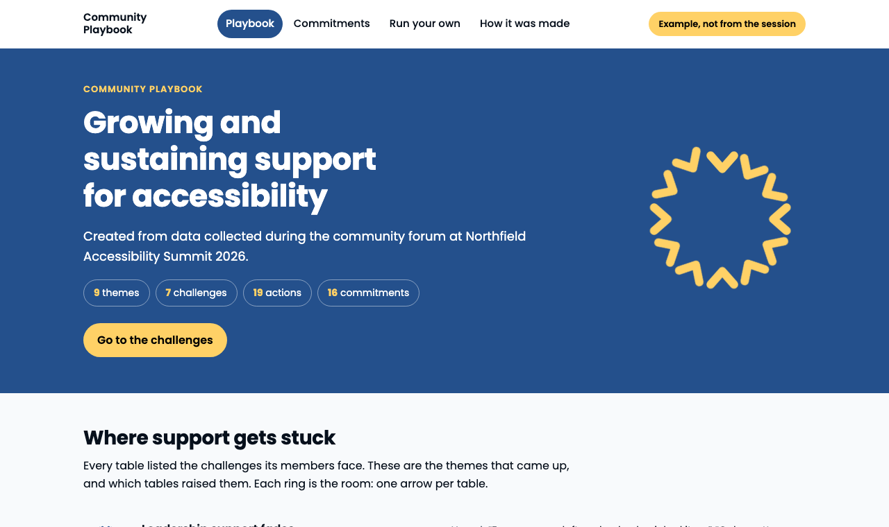

# sheets-to-playbook

Run a workshop on paper, photograph the sheets, and have a website of what people wrote the same afternoon, where every line traces back to something someone wrote. Round tables, retros, or a format of your own: each workshop is a short agenda of exercises, and the sheets, slides, reading, checks and page all come from it.



It comes in four parts:

| Part | What it is | Where |
| --- | --- | --- |
| **Paper kit** | Three A1 worksheets that walk a table from problem to action, a side sheet for quotes and resources, a perforated commitment card and table cards. Print-ready PDFs plus fillable HTML versions. | `print/` |
| **Facilitator slides** | One self-contained HTML deck with built-in timers, and a PDF backup. | `slides/` |
| **Photo-to-playbook engine** | Claude Code reads the photographed handwriting, one sub-agent per table, and writes a draft playbook. Scripts prepare the photos, check coverage and blur, and verify that nothing was invented. | `ingest/`, `.claude/skills/` |
| **Review app and site builder** | A keyboard-first app for confirming uncertain words against close-ups of the photos, and a builder for the finished, accessible website. | `tools/review/`, `build/` |

It was built for the CAN Community Forum (Champions of Accessibility Network) in November 2026, and opened up after people at the session asked to run their own.

## Workshops

| Workshop | What it's for | Sheets | Output |
| --- | --- | --- | --- |
| `round-tables` | A community forum in an hour: where support gets stuck, what has helped or not, what people could try now. Tables of about ten. Public. | 3 A1 sheets, a side sheet, a commitment card, table cards | A playbook: themes, a page per challenge, commitments |
| `retro` | A team retrospective in 45 minutes. Private to the team. | How did it go?, What could we try? (with dot votes), What we'll do | Notes: went well and got in the way, ideas ranked by votes, actions with who and by when |
| `ideation` | An ideas session in 40 minutes. Private. | What could we try? (a "How might we" question and twelve idea boxes with dot votes), What we'll do | Ideas ranked by votes, actions |
| `pre-mortem` | Before a project starts, 30 minutes: imagine it failed. Private. | Imagine it failed: what went wrong?, What we'll do about it | Risks, most likely first, with what to do about each; actions |
| `business-change` | Plan a change people will feel, in an hour. Private. | Who does this change affect?, Who needs to be involved?, How ready are we? (five areas scored 1 to 5), What could go wrong?, What we'll do | What changes and for whom, people by influence, a readiness table, risks, actions |

`python3 tools/new_event.py` lists them, and `python3 tools/new_event.py retro events/q4-retro` sets up a settings file for one. Every builder then takes it with `--config`.

Every workshop but round tables gets its notes page from one generic layout (`build/views-generic.js`), described in its `output.json`: lists side by side, ideas ranked by votes, cards, score tables. A new workshop needs no code.

**Make your own** in `formats/`: an exercise is one sheet (`formats/exercises/<id>.json`: its question and boxes, laid out in rows), and a workshop strings exercises together (`formats/workshops/<id>/`: the agenda, what the page holds and how each part is checked, the page's views and how to write it). Box types are text, list, ranked, tally, row (a repeating group like an action with who and by when, or a table of rows with tick boxes, printed row labels and single-choice ticks), list+votes (ideas with dot votes) and name. Exercises so far: the round-table sheets, went-well, ideas-votes, actions, pains, now-next-later, risks, stakeholders, success-criteria, scale and impact. An agenda can reword an exercise's boxes for its own workshop. The sheets, the fill-in pages, the slides, the readers' brief (`ingest.py brief`), `verify` and the review app all follow. `tests/hw/make_format_test.py` makes synthetic handwritten photos of a new workshop's sheets from an answer bank, so you can measure how well they're read before using them for real. Another repository can keep its own formats and point at them with `formats` in its settings.

## How it works

1. **Before the day:** pick a workshop, set your names and colours in `playbook.config.json`, then build the paper kit and the slides. (The steps below are for round tables; other workshops work the same way with their own sheets.)
2. **On the day:** each table works through the three sheets. A table lead writes, everyone else talks. People fill in a commitment card, tear off the stub and hand it in.
3. **Straight after:** photograph every sheet and every stub. Hand the folder to Claude Code: *"build the playbook from this folder"*.
4. **Claude prepares and checks the photos**, tells you at once if a sheet is missing or blurred (while it's still on the wall), then reads every table in parallel.
5. **It writes a draft playbook** and a review pack. Every line cites the photo it came from; `verify` fails anything it can't trace, any quote that drifted from the words on the sheet, and any name left in.
6. **A person reviews it.** Uncertain words are flagged, never guessed; the review app gets through them quickly.
7. **Publish:** one command builds a static site you can host anywhere.

[On the day](docs/on-the-day.md) has the timeline, roles and commands.

## The rules it keeps

- **Nothing invented.** Every line on the page traces to a photo. Empty is better than plausible. Claude may not add examples, statistics or advice from general knowledge, and `ingest.py verify` enforces it.
- **Uncertain words stay marked.** A word that can't be read for certain is written `[?word]` and goes to a human. In our handwriting stress tests (synthetic handwriting on the real sheets, `tests/hw/`), round 3 had no unflagged errors in 135 items. Real handwriting is harder; the human review is not optional.
- **Anonymous by default.** Names of people and employers are removed from everything except a commitment card's optional Name and Organisation lines, which the card asks people to fill in only if they're happy to be named.
- **Accessible.** The site, slides and HTML sheets are built to WCAG 2.2 AA: real headings and landmarks, labelled controls, full keyboard use, and contrast checked in light and dark mode. If your brand colours would fail contrast, the builder adjusts them and tells you.

## What you need

- **Claude Code**, for reading the handwriting and writing the playbook. The readers run as sub-agents, one per table. Without it, you can type the sheets in yourself and every check and build still works: see [On the day](docs/on-the-day.md#if-claude-isnt-available).
- **Python 3.9 or later** and the packages in `requirements.txt`: `pip install -r requirements.txt`.
- **A Mac is easiest.** The review app's close-ups use Apple's Vision text recognition, which needs Xcode's command line tools (`xcode-select --install`), and iPhone HEIC photos convert with the built-in `sips`. On Linux or Windows, everything still works: install `pillow-heif` for HEIC photos, and the review app shows whole photos instead of close-ups.
- **Optional:**
  - Node and Playwright, for the slides' PDF backup (`slides/README.md`).
  - Whisper and ffmpeg, if you record voice notes as well: `pip install openai-whisper` (or `brew install openai-whisper ffmpeg` on a Mac).
  - Poppler (`pdftoppm`), scipy and an internet connection the first time, for the handwriting stress tests (`tests/README.md`).

New to the vocabulary (table lead, stub, run, readers)? There's a short glossary at the top of [On the day](docs/on-the-day.md).

## Quick start

```bash
git clone https://github.com/Chris-Keene/sheets-to-playbook.git && cd sheets-to-playbook
pip install -r requirements.txt

python3 build/build.py                 # the example playbook and a blank template, in playbook/
python3 print/build_paper.py           # print-ready kit in print/out/paper/, zipped in print/out/
python3 print/build_sheets_html.py     # fillable HTML sheets in print/out/html/
python3 slides/build_slides.py         # slides/out/slides.html
```

Open `playbook/index.html` to see what you'll end up with. Every build reads `playbook.config.json`; try `--config examples/can/playbook.config.json` on any of them to see a fully branded version.

Then open Claude Code in this folder. The `sheets-to-playbook` skill is picked up automatically. To use it from anywhere, run `python3 tools/install_skill.py`.

## Make it yours

`playbook.config.json` holds everything that isn't content:

| Setting | Used for |
| --- | --- |
| `org.short`, `org.name` | "About CAN", sheet footers, the header wordmark when there's no logo |
| `org.forum`, `org.team` | Sentences on the site: "created during the *community forum*", "*the organisers* photographed every sheet" |
| `org.about`, `org.join` | The About page and the closing band (a link to join your network) |
| `workshop`, `formats` | Which workshop (`round-tables` unless you say otherwise), and any folders of your own formats to search first |
| `playbook.name`, `playbook.url` | Page titles and footers; **the QR code on the commitment card points at the url**, so set it before printing |
| `playbook.searchable` | `false` (the default) keeps every page out of search results. Set `true` to let search engines list the final playbook; drafts never are. |
| `playbook.file_name` | What "Download this playbook" saves as. Default: the playbook's name, e.g. `community-playbook.html`. |
| `playbook.share` | Optional link previews for LinkedIn, Slack and Teams once the playbook is online: `{"image": "share.jpg", "image_alt": "..."}`. Needs `playbook.url`. The picture is copied beside the page. |
| `brand.accent`, `brand.highlight` | Two colours. Every other shade, in light and dark mode, is worked out from them and checked for contrast. |
| `brand.logo` | Optional SVG or PNG logos (`primary`, `secondary`, `mark`), relative to the settings file. Without one, the name is set as a wordmark. An SVG takes the page's logo colour so it follows dark mode; set `"keep_colours": true` to keep its own colours. A logo in its own colours (or a PNG) can have a second file for dark backgrounds: `secondary_dark` and so on. The print kit draws SVGs only; with a PNG it uses the wordmark. |
| `brand.font` | The typeface for every page, sheet and slide: `{"family": "Outfit", "files": {"Regular": ..., "Medium": ..., "SemiBold": ..., "Bold": ...}}`. Use static woff2 (or TTF) files, not a variable font: the print kit draws its lettering from them too. Poppins by default. |
| `brand.palette` | Optional exact colours, if you'd rather set every shade yourself (still contrast-checked) |
| `brand.cmyk` | Optional print colours your printer has proofed, `{"accent": [c, m, y, k], "highlight": [...]}`. Otherwise the kit converts your hex colours, which is fine for an office printer but worth proofing for a print shop. |
| `kit.licence` | The licence line on the playbook's "Run your own" page. The default keeps the CC BY credit the kit needs when you pass it on. |
| `kit.source` | Where the tools live, linked from the "Run your own" page. `""` leaves the link out. |
| `credit` | The small "Built with sheets-to-playbook by Chris Keene" line, with its logo, at the foot of every playbook. `{"show": false}` switches it off. |

`examples/can/playbook.config.json` is a complete worked example (the logo files aren't included: see `examples/can/brand/README.md`).

## Privacy

Photos of sheets can include names, faces in the background and the odd phone number.

- The scripts run on your machine. Photos reach Claude only through Claude Code, to be read. (`verify --links` also checks that resource links on the sheets still work, which contacts those sites.)
- The folders that hold event data (`runs/`, `inbox/`, `data/session.json`) are ignored by git, so they can't be committed by accident.
- The published playbook stays out of search results unless you set `playbook.searchable`.
- Once the playbook is final, delete the photos, voice notes and runs you agreed not to keep.

## Repository map

```
.claude/skills/sheets-to-playbook/   the Claude Code skill: the whole day, stage by stage
ingest/ingest.py                     prepare, status, verify, draft, review, publish
ingest/RAW_FORMAT.md                 how handwriting is transcribed, and the rules every workshop's writing follows
formats/                             the workshops: exercises (one per sheet or card) and agendas, recipes and page views
build/                               site builder, settings and colour maths, templates
print/                               paper kit: PDFs and fillable HTML
slides/                              facilitator deck
tools/review/                        the review app (see its README)
tools/install_skill.py               install the skill for every Claude Code session
docs/on-the-day.md                   runbook: before, straight after, and if Claude isn't available
examples/                            an example playbook, a blank template, and the CAN settings
tests/                               fixtures and handwriting stress tests (see tests/README.md)
```

## Licence

- **Code:** MIT (`LICENSE`).
- **Workshop kit** (sheets, cards, slides and written guidance): CC BY 4.0 (`LICENSE-CONTENT.md`). Adapt it freely; credit *sheets-to-playbook by Chris Keene*.
- **Poppins** typeface: SIL Open Font License (`assets/fonts/OFL.txt`).

## Credits

<a href="https://chriskeene.me"></a> Designed and built by [Chris Keene](https://chriskeene.me), first for the CAN Community Forum. Built with Claude Code.

Every page the kit makes says so in a small line at its foot ("Built with sheets-to-playbook by Chris Keene"), and on the slides' last card. Keep it if you can; `"credit": {"show": false}` in the settings takes it off.
