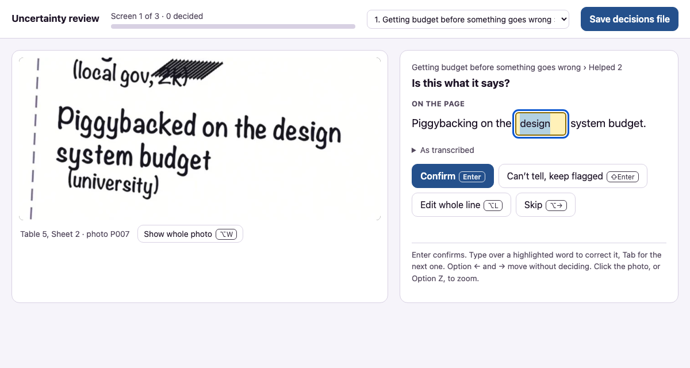

# Review app

A fast way through the uncertain readings in a draft playbook. One screen per `[?word]` or `[illegible]`, each with a close-up of the handwriting, so a reviewer can confirm or correct dozens of words in a few minutes, by keyboard.



## Use it

```bash
python3 tools/review/make_review.py              # works on runs/latest; --run <folder> for another run
open runs/latest/review/index.html               # or double-click it
```

The reviewer goes through the screens:

- **Enter** confirms the highlighted reading. Type over a word to correct it; Tab moves to the next one.
- **Shift+Enter** keeps the word flagged (can't tell).
- **Option+L** edits the whole line. **Option+W** shows the whole photo. **Option+Z** or a click zooms.
- Progress is kept in the browser, so it's safe to close the tab and come back.

At the end they press **Save decisions file**. Then:

```bash
python3 tools/review/apply_review.py ~/Downloads/review-decisions-<run>.json    # wherever your browser saved it
python3 ingest/ingest.py verify
python3 ingest/ingest.py draft
```

Leave the path out and it uses the newest `review-decisions-<run>*.json` in `~/Downloads`.

`apply_review.py` writes each reading into the raw transcriptions and into `session.json`, so `verify` still matches quotes and cards word for word. Running it twice does no harm. Checks and calls need judgement, so it lists them in `<run>/review/to-action.md` for Claude (or you) to act on.

## Extra screens: `extra.json`

Not every question is an uncertain word. While writing the playbook, Claude can add screens for a run in `<run>/review/extra.json`:

```json
{
  "notes":  {"T10.S2.lesson7": "On the sharper retake (P049) the two small labels look like \"KPIs\" and \"Root cause\". That's Claude's reading, not the table reader's."},
  "checks": [{"src": "T02.S3.action3", "note": "The \"Established\" mark is a flat stroke over the E. Read as ticked. Ticked, or crossed out?"}],
  "calls":  [{"key": "merge-t10", "src": [], "text": "Table 10 has its own page. Merge it into leadership buy-in?", "options": ["Keep it separate", "Merge it"]}]
}
```

- **notes** are added to a reading's screen, next to the table reader's own notes. Say whose reading it is.
- **checks** ask the reviewer to look at the photo: "Looks right" or "Needs a change" with a note.
- **calls** are choices only a person can make (naming a resource, merging two tables). `src` may be empty; give two to four options.

## Close-ups need a Mac

Close-ups come from Apple's Vision text recognition. `ocr.swift` is compiled the first time it's needed, which needs Xcode's command line tools (`xcode-select --install`). Each photo is turned upright from the angle of its text lines, read, and the handwriting that best matches the transcription is cropped with its neighbours. Results are cached in `<run>/review/ocr/`.

On Linux or Windows, or with `--no-ocr`, every screen shows the whole photo instead. The app still works; it's just slower to find each line.

The matcher ignores the paper kit's printed headings, plus the playbook and organisation names from your settings file (`--config` if it isn't `playbook.config.json`). If you've rewritten the questions on the sheets, add the new headings to `PRINTED` in `make_review.py`.
